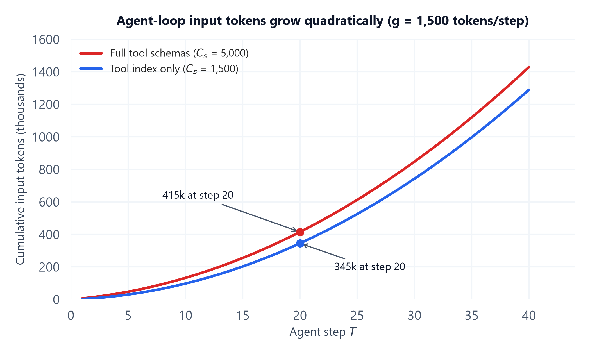

# Module 01: Context Engineering as a Discipline

> **Builds on:** `05_prompt_engineering_and_structured_generation` Module 06 (context assembly, budget allocation, "lost in the middle") and `04_ai_agents_and_protocols` Module 04 (context vs state vs memory). This module does not repeat those. It covers the agent-loop view: what the model sees at *every step*, and what that costs.

## 1. Introduction & Intuition

### The Core Bottleneck
Prompt engineering optimizes one instruction for one call. An agent makes dozens of calls in a loop, and at every step the model re-reads everything in its context window: the system prompt, every tool definition, everything retrieved so far, and the full history of its own actions and their results. Context is no longer a prompt you write once. It is a data structure that the harness rebuilds on every step, and it grows on its own as the agent works.

That growth causes three problems at once:
* **Cost and latency.** Every step pays for every token in the window. Step 20 pays for steps 1–19 again.
* **Quality.** Accuracy drops as the window fills with stale tool output and near-miss content (Module 02, "context rot").
* **Fixed overhead.** Tool definitions, a system prompt and project instructions are paid on every step before the agent does anything useful. Connecting a few MCP servers can add thousands of tokens of tool schemas to every call.

**Context engineering** is the discipline of deciding, at each step, which tokens earn their place in the window.

### High-Level Intuition
Think of the context window as a desk, not a filing cabinet. The model can only work with what is on the desk, and the desk is cleared and re-laid at every step. A good assistant keeps the desk sparse: today's task, the two documents that matter, a short note about what was already tried. Everything else goes in labeled drawers (files, memory stores, sub-agents) that can be opened on demand. A bad assistant piles every page they have ever touched onto the desk and then wonders why they keep misreading things, and why every step takes longer.

---

## 2. Core Concepts & Mathematical Formulation

### Prompt Engineering vs Context Engineering

| | Prompt engineering | Context engineering |
|---|---|---|
| **Unit of design** | One instruction / template | Everything the model sees at each step |
| **When it is decided** | At authoring time | At runtime, every step, by the harness |
| **Main levers** | Wording, examples, format | What to include, exclude, persist, summarize, or delegate |
| **Main failure** | Ambiguous or under-specified instructions | Bloated, stale or distracting context; runaway cost |
| **Owned by** | Topic `05` | This topic |

Prompt engineering still matters: the system prompt is part of the context. But for an agent, the wording of the system prompt is usually a small share of what goes wrong. The bigger share is what *else* ends up in the window.

### Anatomy of One Agent Step's Context
Every agent step's window can be split into segments, each with a different lifetime and a different owner:

| Segment | Example | Static or dynamic | Typical owner |
|---|---|---|---|
| System prompt | Role, rules, output format | Static | Developer |
| Project instructions | `AGENTS.md` / `CLAUDE.md`-style file | Static per session | Developer / user (Module 04) |
| Tool definitions | JSON schemas of every tool | Static per session | Tool providers (MCP servers) |
| Retrieved content | RAG chunks, file contents | Dynamic | Retrieval layer (topic `03`) |
| Conversation / action history | User turns, tool calls, tool results | Dynamic, grows every step | Harness |
| Memory | Summaries, facts recalled from long-term store | Dynamic | Memory layer (topic `04` Module 04) |
| Scratchpad | The model's own plan or notes for this step | Dynamic | Model |

The static/dynamic split is not just bookkeeping. Static segments can be cached at a fraction of the price if they come first and never change (Module 03). Dynamic segments are where growth, staleness and distractors come from.

### The Four Operations: Write, Select, Compress, Isolate

Almost every context-engineering technique is one of four operations:

| Operation | What it does | Examples | Main trade-off |
|---|---|---|---|
| **Write** | Persist information *outside* the window so it survives | Notes files, scratchpads saved to disk, long-term memory writes, checkpoints | Needs a later *select* to be useful; stale notes mislead |
| **Select** | Pull information *into* the window only when needed | RAG, just-in-time file reads, loading a tool's schema only when relevant | Retrieval misses = the model never sees the fact |
| **Compress** | Shrink what is already in the window | Summarizing old turns, trimming tool output, dropping resolved sub-tasks | Lossy; can silently drop a critical constraint; invalidates caches (Module 03) |
| **Isolate** | Split context across separate windows | Sub-agents with clean windows, sandboxed code execution that returns only results | More total tokens; information lost at the hand-off |

<div style="max-width: 100%; overflow-x: auto;">
<svg viewBox="0 0 800 360" width="100%" height="auto" xmlns="http://www.w3.org/2000/svg" style="background-color: #f8fafc; border: 1px solid #e2e8f0; border-radius: 8px; font-family: system-ui, -apple-system, sans-serif;">
  <defs>
    <marker id="m01arrow" markerWidth="10" markerHeight="7" refX="9" refY="3.5" orient="auto"><polygon points="0 0, 10 3.5, 0 7" fill="#475569"/></marker>
  </defs>
  <text x="400" y="28" text-anchor="middle" font-size="16" font-weight="bold" fill="#0f172a">One Agent Step's Context Window and the Four Operations</text>
  <rect x="270" y="50" width="260" height="290" rx="10" fill="#ffffff" stroke="#334155" stroke-width="2"/>
  <text x="400" y="72" text-anchor="middle" font-size="13" font-weight="bold" fill="#0f172a">Context window (step t)</text>
  <rect x="290" y="84" width="220" height="30" rx="5" fill="#dbeafe" stroke="#3b82f6"/>
  <text x="400" y="104" text-anchor="middle" font-size="12" fill="#1e3a8a">System prompt — static</text>
  <rect x="290" y="120" width="220" height="30" rx="5" fill="#dbeafe" stroke="#3b82f6"/>
  <text x="400" y="140" text-anchor="middle" font-size="12" fill="#1e3a8a">Tool definitions — static</text>
  <rect x="290" y="156" width="220" height="30" rx="5" fill="#dbeafe" stroke="#3b82f6"/>
  <text x="400" y="176" text-anchor="middle" font-size="12" fill="#1e3a8a">Project instructions — static</text>
  <rect x="290" y="192" width="220" height="30" rx="5" fill="#fef3c7" stroke="#d97706"/>
  <text x="400" y="212" text-anchor="middle" font-size="12" fill="#78350f">Retrieved content — dynamic</text>
  <rect x="290" y="228" width="220" height="30" rx="5" fill="#fef3c7" stroke="#d97706"/>
  <text x="400" y="248" text-anchor="middle" font-size="12" fill="#78350f">Memory recall — dynamic</text>
  <rect x="290" y="264" width="220" height="60" rx="5" fill="#fee2e2" stroke="#dc2626"/>
  <text x="400" y="288" text-anchor="middle" font-size="12" fill="#7f1d1d">History + tool results</text>
  <text x="400" y="306" text-anchor="middle" font-size="12" fill="#7f1d1d">dynamic, grows every step</text>
  <rect x="30" y="80" width="190" height="66" rx="8" fill="#ecfdf5" stroke="#059669" stroke-width="1.5"/>
  <text x="125" y="104" text-anchor="middle" font-size="13" font-weight="bold" fill="#065f46">SELECT</text>
  <text x="125" y="124" text-anchor="middle" font-size="11" fill="#065f46">pull in just in time</text>
  <text x="125" y="138" text-anchor="middle" font-size="11" fill="#065f46">(RAG, file reads, tool lookup)</text>
  <line x1="220" y1="113" x2="284" y2="205" stroke="#475569" stroke-width="1.5" marker-end="url(#m01arrow)"/>
  <rect x="30" y="230" width="190" height="66" rx="8" fill="#ecfdf5" stroke="#059669" stroke-width="1.5"/>
  <text x="125" y="254" text-anchor="middle" font-size="13" font-weight="bold" fill="#065f46">COMPRESS</text>
  <text x="125" y="274" text-anchor="middle" font-size="11" fill="#065f46">summarize / trim</text>
  <text x="125" y="288" text-anchor="middle" font-size="11" fill="#065f46">what is already inside</text>
  <line x1="220" y1="268" x2="284" y2="290" stroke="#475569" stroke-width="1.5" marker-end="url(#m01arrow)"/>
  <rect x="580" y="80" width="190" height="66" rx="8" fill="#eef2ff" stroke="#4f46e5" stroke-width="1.5"/>
  <text x="675" y="104" text-anchor="middle" font-size="13" font-weight="bold" fill="#3730a3">WRITE</text>
  <text x="675" y="124" text-anchor="middle" font-size="11" fill="#3730a3">persist outside the window</text>
  <text x="675" y="138" text-anchor="middle" font-size="11" fill="#3730a3">(notes, memory, checkpoints)</text>
  <line x1="516" y1="280" x2="575" y2="125" stroke="#475569" stroke-width="1.5" marker-end="url(#m01arrow)"/>
  <rect x="580" y="230" width="190" height="66" rx="8" fill="#eef2ff" stroke="#4f46e5" stroke-width="1.5"/>
  <text x="675" y="254" text-anchor="middle" font-size="13" font-weight="bold" fill="#3730a3">ISOLATE</text>
  <text x="675" y="274" text-anchor="middle" font-size="11" fill="#3730a3">sub-agents / sandboxes</text>
  <text x="675" y="288" text-anchor="middle" font-size="11" fill="#3730a3">return only a summary</text>
  <line x1="575" y1="275" x2="516" y2="296" stroke="#475569" stroke-width="1.5" marker-end="url(#m01arrow)"/>
</svg>
</div>

*Blue segments are static and cacheable (Module 03). Amber segments are pulled in by **select**. The red history segment is where growth happens, and it is the target of **compress**. **Write** moves information out to durable storage; **isolate** moves work into a separate window and brings back only a summary.*

### Formula: Cumulative Input Tokens of an Agent Loop

#### Purpose & Intuition
This is the number that motivates the whole topic. If a loop re-reads its entire history on every step, total input tokens grow with the *square* of the number of steps, not linearly. A 2x longer task costs roughly 4x as much, and the static overhead (tool definitions, system prompt) is multiplied by every step.

Let $C_s$ be the static context (system prompt + tool definitions + instructions) in tokens, and suppose each step adds $g$ tokens of history (the model's action plus the tool result). Step $t$ reads $C_s + g\,t$ tokens. Over $T$ steps:

$$\text{Tokens}_{\text{total}} = \sum_{t=1}^{T} \big(C_s + g\,t\big) = T\,C_s + g\,\frac{T(T+1)}{2}$$

* The first term $T\,C_s$ is the **static tax**: linear in $T$, and attacked by trimming tool definitions and caching (Module 03).
* The second term $g\,T(T+1)/2$ is the **history term**: quadratic in $T$, and attacked by *compress*, *isolate* and by keeping tool results small.

#### Hand Calculation
A coding agent: $T = 20$ steps, $C_s = 5{,}000$ tokens (system prompt 1,000 + 20 tool schemas at about 200 each), $g = 1{,}500$ tokens per step.

1. Static tax: $T\,C_s = 20 \times 5{,}000 = 100{,}000$ tokens.
2. History term: $\frac{T(T+1)}{2} = \frac{20 \times 21}{2} = 210$, so $g \times 210 = 1{,}500 \times 210 = 315{,}000$ tokens.
3. Total: $100{,}000 + 315{,}000 = 415{,}000$ input tokens, for a task whose *final* window is only $5{,}000 + 1{,}500 \times 20 = 35{,}000$ tokens.

Now apply *progressive disclosure* (Module 04): replace 20 full tool schemas with a short tool index and load schemas on demand, cutting $C_s$ from 5,000 to 1,500 tokens.

4. New static tax: $20 \times 1{,}500 = 30{,}000$. History unchanged: $315{,}000$. New total: $345{,}000$.
5. Saving: $415{,}000 - 345{,}000 = 70{,}000$ tokens (17%), all from the static term.

Two lessons. First, the quadratic history term dominates, so trimming tool output and compressing history usually matter more than trimming tools. Second, the static saving grows linearly with task length, so it matters more for long tasks and for high-volume agents that run thousands of short loops.

**Shape tracking:** inputs are scalars ($T$, $C_s$, $g$, all in tokens); output is a scalar token count. Per-step window size is a length-$T$ vector $[C_s + g, \dots, C_s + gT]$ whose sum is the total.



*Computed directly from the hand calculation above. The curves bend upward because every step re-reads all prior history. Trimming tool definitions shifts the curve down by a gap that grows linearly with step count; it does not change the curvature. Only compress and isolate attack the curvature.*

### Worked Example (No Formula): Labeling One Step's Context
Step 14 of the same coding agent, broken down by segment, with the operation that applies to each:

| Segment | Tokens | Static / dynamic | What to do |
|---|---|---|---|
| System prompt | 1,000 | Static | Keep; put first so it caches |
| 20 tool schemas | 4,000 | Static | **Select**: keep a 300-token index, load the 3 schemas actually used |
| Project instructions | 800 | Static | Keep; versioned in the repo |
| Two retrieved files | 6,000 | Dynamic | **Select**: read only the relevant functions, not whole files |
| History: 13 prior steps | 19,500 | Dynamic | **Compress**: replace raw test logs from steps 2–9 with a 300-token summary of what failed |
| A 4,000-line search result | 9,000 | Dynamic | **Isolate**: run the search in a sub-agent that returns the 5 relevant hits |
| Plan / scratchpad | 400 | Dynamic | **Write**: also save to a notes file so it survives a reset |
| **Total** | **40,700** | | |

Applying the four operations brings this step to roughly 12,000 tokens without removing anything the model needs for step 14.

---

## 3. Implementation & Reference Code

A deterministic token-budget calculator for an agent loop. It reproduces the hand calculation, breaks a single step down by segment, and shows where each operation saves tokens.

```python
from dataclasses import dataclass, field

@dataclass
class Segment:
    name: str
    tokens: int
    static: bool            # static segments are paid on every step and are cacheable

@dataclass
class AgentLoopBudget:
    segments: list = field(default_factory=list)   # static + initial dynamic segments
    growth_per_step: int = 0                        # g: history tokens added per step

    @property
    def static_tokens(self) -> int:                 # C_s
        return sum(s.tokens for s in self.segments if s.static)

    def window_at_step(self, t: int) -> int:
        """Tokens the model reads at step t (1-indexed): C_s + g*t."""
        return self.static_tokens + self.growth_per_step * t

    def total_input_tokens(self, T: int) -> int:
        """Closed form: T*C_s + g*T*(T+1)/2."""
        return T * self.static_tokens + self.growth_per_step * T * (T + 1) // 2

    def per_step_windows(self, T: int) -> list:      # shape: [T]
        return [self.window_at_step(t) for t in range(1, T + 1)]


baseline = AgentLoopBudget(
    segments=[Segment("system_prompt", 1_000, True),
              Segment("tool_schemas", 4_000, True)],
    growth_per_step=1_500,
)
trimmed = AgentLoopBudget(
    segments=[Segment("system_prompt", 1_000, True),
              Segment("tool_index", 500, True)],     # progressive disclosure
    growth_per_step=1_500,
)

T = 20
windows = baseline.per_step_windows(T)               # [20]
assert len(windows) == T
assert sum(windows) == baseline.total_input_tokens(T) == 415_000   # closed form == loop sum
assert windows[-1] == 35_000                                       # final window size
assert trimmed.total_input_tokens(T) == 345_000
saving = baseline.total_input_tokens(T) - trimmed.total_input_tokens(T)
assert saving == 70_000

# Static tax vs history term, to see which one dominates
static_tax = T * baseline.static_tokens                            # 100,000
history_term = baseline.growth_per_step * T * (T + 1) // 2         # 315,000
assert static_tax + history_term == 415_000
print(f"total={baseline.total_input_tokens(T):,} static={static_tax:,} "
      f"history={history_term:,} saving_from_trim={saving:,}")

# Doubling task length roughly quadruples the history term
assert baseline.total_input_tokens(40) - 40 * baseline.static_tokens == 1_500 * 40 * 41 // 2
ratio = (1_500 * 40 * 41 // 2) / history_term
print(f"history term grows {ratio:.2f}x when T doubles 20 -> 40")   # ~3.90x
```

---

## 4. Interview Deep-Dive & System Trade-offs

### 1. Architectural & Production Trade-offs
* **Core Problem Solved:** Agents re-read their whole context on every step, so cost, latency and error rates all grow with how much is in the window. Context engineering treats the window as a budgeted resource that the harness rebuilds each step.
* **Why Introduced over Legacy Approaches:** Prompt engineering tunes a single instruction, and "just use a bigger context window" assumes more tokens are free and harmless. Neither holds for multi-step agents: cost grows quadratically with task length, and quality degrades with length (Module 02).
* **Key Failure Modes & Limitations:** Over-stuffing (everything retrieved stays forever); under-selecting (a retrieval miss means the model never sees a needed fact); lossy compression that drops a constraint; tool-definition bloat from connecting many MCP servers; isolation that loses information at the hand-off.

### 2. System Complexity & Scaling
* **Time Complexity (FLOPs):** Input processing per step is proportional to window size, so a loop without compression is $\mathcal{O}(T\,C_s + g\,T^2)$ tokens in total. Prefill attention per step is $\mathcal{O}(L^2)$ in window length $L$, making long windows slower as well as costlier (see topic `06`).
* **Space/Memory Footprint:** KV cache per request grows linearly with window length on the serving side (topic `06`); on the harness side, notes files and memory stores grow without bound unless pruned.
* **Primary Bottleneck Type:** Cost and time-to-first-token are dominated by prefill over a long window (compute-bound prefill; memory-bound decode). Quality is bottlenecked by distractors, not by window capacity.
* **Variable Legend:** $T$ = number of agent steps; $C_s$ = static context tokens per step; $g$ = history tokens added per step; $L$ = window length at a given step.

### 3. Production & Scalability
* **Deployment Considerations:** Log the per-segment token breakdown of every step, not just the total, so you can see which segment is growing. Put static segments first and keep them byte-identical so provider caching works (Module 03). Cap tool-result size at the harness (truncate, or return a handle plus summary). Budget tool definitions as a fixed cost per connected MCP server.
* **Common Interviewer Follow-Up Questions:**
    1.  *Q:* What is the difference between prompt engineering and context engineering?
        *   *A:* Prompt engineering designs a single instruction at authoring time. Context engineering decides, at runtime and on every step, what the model sees: which tools, which retrieved content, how much history, what memory, and what gets moved out to files or sub-agents. For agents, most failures come from *what else* is in the window, not from the instruction's wording.
    2.  *Q:* Your agent's cost doubled after you made tasks 40% longer. Why, and what do you do?
        *   *A:* Total input tokens are $T\,C_s + g\,T(T+1)/2$, so the history term grows with the square of task length: $1.4^2 \approx 2$. Fixes in order of impact: shrink $g$ (truncate or summarize tool results before they enter history), compress old history once it passes a threshold, isolate large exploratory sub-tasks in sub-agents, and only then trim the static tax $C_s$ and make sure it is cached.
    3.  *Q:* Name the four context-engineering operations and one risk of each.
        *   *A:* Write (stale notes mislead later steps), select (a retrieval miss hides a needed fact), compress (lossy; can drop a constraint and invalidates the prompt cache), isolate (more total tokens, and detail lost when a sub-agent summarizes).
