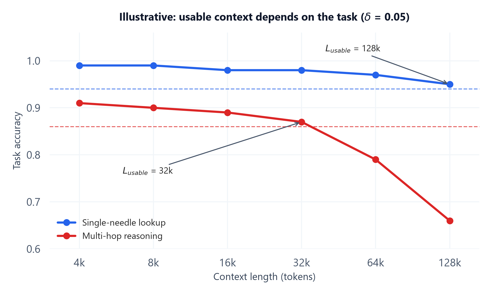

# Module 02: Context Rot & Long-Context Degradation

> **Builds on:** `05_prompt_engineering_and_structured_generation` Module 06 owns *position bias* ("lost in the middle": facts in the middle of a prompt are used less than facts at the edges). This module covers a different effect: accuracy dropping as total length grows, wherever the fact sits. Attention and KV-cache mechanics are owned by `01_llm_foundations` and `06_llm_inference_and_optimization`.

## 1. Introduction & Intuition

### The Core Bottleneck
Model cards advertise context windows of hundreds of thousands to millions of tokens. It is tempting to read that as "I can put everything in and the model will use it." Production experience and controlled studies say otherwise: as input length grows, models become less reliable *even on simple tasks, and even when the needed fact is clearly present*. Chroma's July 2025 technical report, *Context Rot*, tested 18 models (including GPT-4.1, Claude 4, Gemini 2.5 and Qwen3) on deliberately simple, controlled tasks where only input length changed, and found performance degrading, often non-uniformly, as inputs grew. A 2024 Databricks long-context RAG study similarly found answer correctness for many models starting to fall at around 32k tokens, far below their advertised limits.

For an agent, this matters more than for a single call: the window fills up *by itself* as the agent works (Module 01), so an agent that was accurate at step 3 can quietly become unreliable by step 30 with no code change.

### High-Level Intuition
A very long meeting transcript is a fair comparison. Every word of the key decision is in there. But the longer the transcript, the more paragraphs sound *almost* like the decision (an earlier draft, a rejected option, a similar decision about a different project), and the harder it is to pick out the right one and connect it to the three other facts it depends on. Having more text available is not the same as being able to use it. "Context rot" is the name for that gap.

---

## 2. Core Concepts & Mathematical Formulation

### Context Rot vs Position Bias

| | Position bias ("lost in the middle") | Context rot (length-driven degradation) |
|---|---|---|
| **What varies** | *Where* the fact sits | *How much* other text surrounds it |
| **Typical symptom** | Facts in the middle get ignored | Accuracy falls as total length grows, wherever the fact is |
| **Main fix** | Reorder: put key content at the start or end | Reduce: select less, compress, isolate |
| **Owned by** | Topic `05` Module 06 | This module |

The two compound each other: a long window has *more* middle, and more distractors in it.

### Why Accuracy Falls With Length

Plain-language explanations, without formulas, since none of these has a standard closed form that interviewers expect:

* **Attention dilution.** Each generated token spreads a fixed amount of attention across every token in the window. The more tokens there are, the less attention any single relevant span gets, and the more a near-miss span can compete with it.
* **Distractors.** Content that is *semantically close* to the answer but wrong (an older version of a config, a similar function in another file, a rejected plan) is the main cause of wrong answers in long contexts. Chroma's report found that distractors closely related to the target hurt more than unrelated filler, and that lower similarity between the question and the target passage made degradation steeper.
* **Multi-hop reasoning across distance.** Tasks that need several facts combined (A says X, B says Y, therefore Z) degrade much faster than single lookups, because every hop is another chance to pick the wrong span.
* **Training distribution.** Models see far fewer very long, coherent training examples than short ones, so behavior at the far end of the window is the least practiced.

### Advertised vs Effective Context Length
**Needle-in-a-haystack (NIAH)** tests insert one distinctive sentence into unrelated filler and ask for it back. Most frontier models now score near-perfectly on NIAH at their full window. That says little about real use, because the needle is lexically distinctive (easy to match) and there are no distractors.

Harder benchmarks, such as **RULER**-style suites (multiple needles, variable tracking, aggregation, multi-hop question answering) and conversational-memory benchmarks like LongMemEval, show much steeper curves. Many models fall well short of their advertised length on these tasks. The *effective* context length is the length up to which a model still performs acceptably **on your kind of task**, and it is usually a fraction of the advertised one.

| Test type | What it measures | How it usually looks |
|---|---|---|
| Single needle (NIAH) | Can the model find one distinctive fact | Near-flat to full window |
| Multi-needle / aggregation | Can it find and combine many facts | Declines with length |
| Needle + close distractors | Can it pick the right fact among near-misses | Declines sharply |
| Multi-hop QA | Can it chain facts across distance | Declines sharply |

### Formula: Usable Context Limit

#### Purpose & Intuition
Turn "the model supports 1M tokens" into a number you can design around. Measure task accuracy $A(L)$ at a few context lengths $L$, take a short-context baseline $A(L_0)$, choose the drop you can tolerate $\delta$, and take the largest tested length that stays within it:

$$L_{\text{usable}} = \max\{\,L : A(L) \ge A(L_0) - \delta\,\}$$

$L_{\text{usable}}$ then becomes a **hard design input**: the harness triggers compression or isolation (Modules 01 and 04) before the window crosses it, and retrieval is tuned to stay under it.

Two practical notes:
* Measure with **your** task shape and **your** distractors (similar documents, previous versions, real tool output), not generic filler. A flat NIAH curve is not evidence of a flat curve for your task.
* $\delta$ is a product decision. A drafting assistant might accept $\delta = 0.05$; a compliance checker might need $\delta = 0.01$.

#### Hand Calculation
Accuracy measured on 200 test cases per length, for two task types on the same model (numbers are **illustrative**, shaped like published long-context results). Baseline $L_0 = 4\text{k}$, tolerance $\delta = 0.05$.

| Length $L$ | Single-needle lookup $A(L)$ | Multi-hop reasoning $A(L)$ |
|---|---|---|
| 4k | 0.99 | 0.91 |
| 8k | 0.99 | 0.90 |
| 16k | 0.98 | 0.89 |
| 32k | 0.98 | 0.87 |
| 64k | 0.97 | 0.79 |
| 128k | 0.95 | 0.66 |

**Single-needle lookup:**
1. Threshold: $A(L_0) - \delta = 0.99 - 0.05 = 0.94$.
2. Every tested length is $\ge 0.94$ (lowest is 0.95 at 128k).
3. $L_{\text{usable}} = 128\text{k}$, the largest length tested.

**Multi-hop reasoning:**
1. Threshold: $0.91 - 0.05 = 0.86$.
2. 32k gives $0.87 \ge 0.86$ (passes); 64k gives $0.79 < 0.86$ (fails).
3. $L_{\text{usable}} = 32\text{k}$.

Same model, 4x difference in usable context, purely because of the task. An agent that mostly does multi-hop work (debugging across files, reconciling records) should be designed around 32k here, not 128k.

**Shape tracking:** input is a table of $n$ (length, accuracy) pairs, i.e. two length-$n$ vectors; output is a scalar length. With 200 cases per length and 6 lengths, the experiment costs $200 \times 6 = 1{,}200$ runs per task type.



*Plotted from the illustrative table above. Dashed lines are each task's threshold $A(L_0) - \delta$. The single-needle curve stays above its line all the way to 128k; the multi-hop curve crosses its line between 32k and 64k.*

### Worked Example (No Formula): A Distractor in Practice
An agent fixing a billing bug has read two files:

* `billing/v1/tax.py` (deprecated): `TAX_RATE = 0.18  # GST, applied to all orders`
* `billing/v2/tax.py` (live): `TAX_RATE = 0.18` plus `EXEMPT_CATEGORIES = {"education", "healthcare"}`

Asked "Should a healthcare order be taxed?", a short context containing only `v2` gets it right. After 25 steps, both files are in the window along with 30k tokens of test logs, and the model answers "yes, 18% applies to all orders", quoting the deprecated file's comment. The fact was present; a near-identical, wrong passage won.

Fixes, in order: don't keep deprecated files in context (**select**); when a file is superseded, replace it in history rather than appending (**compress**); have a sub-agent read the billing module and return only the live rules (**isolate**).

---

## 3. Implementation & Reference Code

A small harness to compute $L_{\text{usable}}$ from measurements, plus a measurement loop you can point at a real model. Here a deterministic mock model stands in for the API call.

```python
import random

def usable_context_limit(lengths, accuracies, delta):
    """L_usable = max{ L : A(L) >= A(L0) - delta }, with L0 = shortest length.
    lengths, accuracies: same length n, lengths sorted ascending."""
    assert len(lengths) == len(accuracies) and lengths == sorted(lengths)
    threshold = accuracies[0] - delta
    passing = [L for L, a in zip(lengths, accuracies) if a >= threshold - 1e-9]
    return max(passing)

lengths   = [4_000, 8_000, 16_000, 32_000, 64_000, 128_000]          # [n]
single    = [0.99, 0.99, 0.98, 0.98, 0.97, 0.95]                      # [n]
multi_hop = [0.91, 0.90, 0.89, 0.87, 0.79, 0.66]                      # [n]

assert usable_context_limit(lengths, single, 0.05) == 128_000
assert usable_context_limit(lengths, multi_hop, 0.05) == 32_000
assert usable_context_limit(lengths, multi_hop, 0.01) == 8_000       # stricter tolerance

# A measurement loop you would point at a real model.
# mock_model stands in for an API call: its error rate rises with length and distractors.
def mock_model(context_len, n_distractors, rng):
    p_correct = 0.92 - 0.0000020 * context_len - 0.02 * n_distractors
    return rng.random() < max(p_correct, 0.0)

def measure_curve(model_fn, lengths, n_cases, n_distractors, seed=0):
    rng = random.Random(seed)                                         # deterministic
    return [sum(model_fn(L, n_distractors, rng) for _ in range(n_cases)) / n_cases
            for L in lengths]

curve_clean = measure_curve(mock_model, lengths, n_cases=200, n_distractors=0)
curve_noisy = measure_curve(mock_model, lengths, n_cases=200, n_distractors=3)
print("clean:", [round(a, 2) for a in curve_clean])
print("with 3 close distractors:", [round(a, 2) for a in curve_noisy])
L_clean = usable_context_limit(lengths, curve_clean, 0.05)
L_noisy = usable_context_limit(lengths, curve_noisy, 0.05)
print(f"L_usable clean={L_clean:,}  with distractors={L_noisy:,}")
assert curve_noisy[-1] < curve_clean[-1]       # distractors make long contexts worse
# Note: here both curves give L_usable = 32k, because L_usable is *relative* to each
# curve's own short-context baseline. Distractors lowered accuracy at every length,
# so also check absolute accuracy against your product's floor, not only the drop.
```

In a real run, `mock_model` becomes: build a context of length $L$ from your own documents (with realistic distractors inserted), ask the question, and grade the answer against a gold label.

---

## 4. Interview Deep-Dive & System Trade-offs

### 1. Architectural & Production Trade-offs
* **Core Problem Solved:** Replaces the assumption "a bigger window means more usable capacity" with a measured, task-specific limit that the harness can enforce.
* **Why Introduced over Legacy Approaches:** NIAH-style checks pass almost everywhere and hide the real problem. Distractor-heavy, multi-hop tasks are what agents actually do, and they degrade much earlier.
* **Key Failure Modes & Limitations:** Designing around the advertised window; measuring with synthetic filler instead of realistic distractors; one $L_{\text{usable}}$ for all tasks; never re-measuring after a model upgrade (curves change between model versions).

### 2. System Complexity & Scaling
* **Time Complexity (FLOPs):** Prefill cost grows with $L$ (quadratic attention in $L$, see topic `06`), so long windows are both slower and less accurate. Measuring the curve costs (cases × lengths) model calls per task type.
* **Space/Memory Footprint:** KV cache grows linearly with $L$ per request on the serving side; staying under $L_{\text{usable}}$ also lowers serving memory.
* **Primary Bottleneck Type:** Quality-bound, not capacity-bound: the window has room, but accuracy has already dropped.
* **Variable Legend:** $L$ = context length in tokens; $L_0$ = short baseline length; $A(L)$ = measured task accuracy at length $L$; $\delta$ = tolerated accuracy drop; $L_{\text{usable}}$ = largest length within tolerance.

### 3. Production & Scalability
* **Deployment Considerations:** Keep a small long-context regression suite built from your own data with realistic distractors, and re-run it on every model change. Set compaction and isolation triggers below $L_{\text{usable}}$, not at the window limit. Track window length per agent step in traces, alongside task success, so you can see degradation in production.
* **Common Interviewer Follow-Up Questions:**
    1.  *Q:* The model supports 1M tokens. Why not put the whole codebase in context?
        *   *A:* Because accuracy degrades with length well before the limit, especially with near-duplicate code (old versions, similar functions) acting as distractors and with multi-hop questions. Each call also gets slower and more expensive. Select the relevant files just in time, or have a sub-agent explore and return a summary, and keep the window under a measured $L_{\text{usable}}$.
    2.  *Q:* How would you find the usable context length for your agent?
        *   *A:* Build an eval from your own task: real documents, realistic distractors, gold answers. Run it at several lengths (e.g. 4k to 128k), compute accuracy per length, pick a tolerance $\delta$ with the product owner, and take the largest length within $A(L_0) - \delta$. Do this per task type, and re-run it whenever the model changes.
    3.  *Q:* How is context rot different from "lost in the middle"?
        *   *A:* Lost in the middle is about *position*: the same fact is used less in the middle of the prompt. Context rot is about *length*: accuracy falls as more text surrounds the fact, wherever it sits. Reordering fixes the first; only reducing what is in the window fixes the second.
