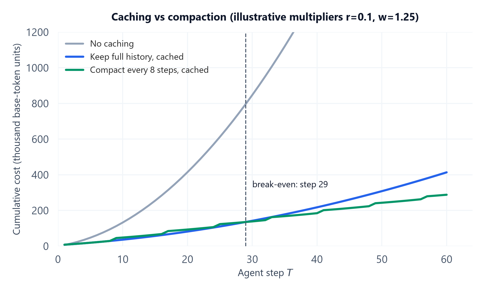

# Module 03: Prompt Caching & Cache-Aware Context Layout

> **Builds on:** `06_llm_inference_and_optimization` owns how prefix caching works inside a serving engine (KV-cache reuse, PagedAttention, prefix trees). This module covers the *application* side: what provider-level prompt caching costs, how to lay out context so it hits, and how caching changes the keep-history vs compact decision. Memory-summarization triggers are owned by `04_ai_agents_and_protocols` Module 04.

## 1. Introduction & Intuition

### The Core Bottleneck
Module 01 showed that an agent loop re-reads its whole history on every step, so input tokens grow quadratically. Most of those tokens are **identical to the previous step**: the same system prompt, the same tool definitions, the same history, plus one new action and result at the end. Prompt caching lets the provider reuse the work it already did on that identical prefix and charge a fraction of the normal input price for it. It also cuts time-to-first-token, because the cached prefix doesn't need to be re-processed.

The catch: caching is **prefix-based and exact**. Change one token near the start (a timestamp, a reordered tool list, a rewritten summary) and everything after it is a cache miss. So caching is not a switch you flip; it is a constraint on how you lay out and edit context. And it changes a decision that looked obvious: if re-reading old history is cheap once cached, *summarizing* that history (which rewrites the prefix) might cost more than keeping it.

### High-Level Intuition
Imagine a printer that charges full price for a new page but 10% for reprinting a page it printed in the last five minutes, *as long as every page before it is also unchanged*. If you keep the cover page and table of contents fixed and only add pages at the end, reprinting the whole document each time is cheap. If you put today's date on the cover page, every reprint is full price. And if you "tidy up" by rewriting chapter 2, everything from chapter 2 onward is full price again.

---

## 2. Core Concepts & Mathematical Formulation

### How Provider Prompt Caching Works (as of late 2026)
Details differ by provider and change often, so treat these as the shape of the mechanism and check current docs for numbers:

| | Anthropic (Claude) | OpenAI | Common to both |
|---|---|---|---|
| **Activation** | Explicit: mark cache breakpoints (`cache_control`) on prompt blocks | Automatic for long enough prompts | Exact prefix match; one changed token ends the cached prefix |
| **Price of a cache read** | 0.1x base input price | Discounted input rate; size of discount varies by model | Much cheaper than an uncached read |
| **Price of a cache write** | 1.25x base input (5-minute TTL), 2x (1-hour TTL) | No write premium | — |
| **Lifetime** | 5 minutes by default, refreshed on each hit; 1-hour option | Minutes of inactivity; extended retention on some models | An idle agent (e.g. waiting on a human) can lose its cache |
| **Minimum size** | A model-dependent minimum number of tokens per cached prefix | Prompts above a minimum length | Short prompts don't cache |
| **Prefix order** | Tools → system → messages | Whatever is first in the request | Changing an early block invalidates everything after it |

Serving engines you host yourself (vLLM, SGLang) do the same thing with automatic prefix caching (topic `06`). There's no price multiplier, but the same layout rules decide your hit rate and your GPU cost.

### Formula: Per-Step Input Cost With Caching

#### Purpose & Intuition
Price one agent step when part of its prompt is a cache hit. Let $p$ be the base input price per token, $r$ the cache-read multiplier, $w$ the cache-write multiplier, $P_{\text{hit}}$ the number of prefix tokens served from cache, and $N_{\text{new}}$ the number of tokens processed fresh and written to cache for the next step:

$$\text{Cost}_{\text{step}} = p\,\big(r\,P_{\text{hit}} + w\,N_{\text{new}}\big)$$

With $r = 0.1$ and $w = 1.25$, a token that stays in a stable prefix costs 1.25x once and 0.1x on every later step, so it pays for itself on the first re-read. A token that keeps changing pays 1.25x every time, which is *more* than no caching at all. That is why layout matters.

#### Hand Calculation: One Step
The Module 01 loop: $C_s = 5{,}000$ static tokens, $g = 1{,}500$ new history tokens per step. Use $p = 1$ (costs in "base-token units").

* **Step 1:** nothing is cached yet. All $5{,}000 + 1{,}500 = 6{,}500$ tokens are written: $1.25 \times 6{,}500 = 8{,}125$.
* **Step 2:** the 6,500 tokens from step 1 are a hit, and 1,500 new tokens are written: $0.1 \times 6{,}500 + 1.25 \times 1{,}500 = 650 + 1{,}875 = 2{,}525$.
* **Step 2 without caching:** $5{,}000 + 2 \times 1{,}500 = 8{,}000$.

The cached step costs 32% of the uncached one, and the ratio keeps improving as the cached prefix grows.

#### Hand Calculation: The Central Trade-off (Keep vs Compact)
Same loop, 20 steps, three policies:

* **(a) No caching:** the Module 01 total, $415{,}000$.
* **(b) Keep full history, cached:** step 1 costs $8{,}125$. Steps 2–20 each read the previous window from cache and write $g$:
  * Cached reads: $0.1 \times \sum_{t=2}^{20}\big(5{,}000 + 1{,}500\,(t-1)\big) = 0.1 \times (95{,}000 + 1{,}500 \times 190) = 0.1 \times 380{,}000 = 38{,}000$.
  * Writes: $19 \times 1.25 \times 1{,}500 = 35{,}625$.
  * Total: $8{,}125 + 38{,}000 + 35{,}625 = 81{,}750$.
* **(c) Compact every 8 steps, cached:** after steps 8 and 16, a summarization call reads the cached window ($0.1\times$) and *generates* a 2,000-token summary at an output multiplier of $5\times$ ($10{,}000$ per compaction). The summary then replaces history, so the next step has only the 5,000 static tokens cached and must write the summary plus new history. The simulator in Section 3 totals this at $93{,}150$.

| Policy | 20 steps | 60 steps |
|---|---|---|
| (a) No caching | 415,000 | 3,045,000 |
| (b) Keep full history, cached | **81,750** | 413,750 |
| (c) Compact every 8 steps, cached | 93,150 | **288,150** |

Up to step 28, keeping everything is cheaper than compacting, because compaction pays for a summary generation *and* a full re-write of the history after it, while keeping pays only cheap cached reads. From **step 29** on, compaction wins, because the kept history has grown large enough that even 0.1x reads of it add up.



*Computed by the simulator in Section 3 with illustrative multipliers $r=0.1$, $w=1.25$, output $5\times$. The compaction curve jumps at each summarization step, then grows slowly; the keep-everything curve grows smoothly but faster.*

**But cost is only half the decision.** Under policy (b), the window at step 20 is $5{,}000 + 20 \times 1{,}500 = 35{,}000$ tokens, already past the 32k usable limit measured for multi-hop work in Module 02. So the real rule is: **compact when the window approaches $L_{\text{usable}}$ or the cost break-even, whichever comes first**, and never on a fixed schedule just because summarizing "feels tidier".

**Shape tracking:** per policy, input is the per-step window sizes (a length-$T$ vector) and which prefix length is cached at each step; output is a scalar cumulative cost and a length-$T$ vector of per-step costs.

### Cache-Aware Layout
Order context from most stable to least stable, and keep each stable block byte-identical across steps:

<div style="max-width: 100%; overflow-x: auto;">
<svg viewBox="0 0 820 300" width="100%" height="auto" xmlns="http://www.w3.org/2000/svg" style="background-color: #f8fafc; border: 1px solid #e2e8f0; border-radius: 8px; font-family: system-ui, -apple-system, sans-serif;">
  <text x="410" y="28" text-anchor="middle" font-size="16" font-weight="bold" fill="#0f172a">Cache-Aware Prompt Layout (most stable first)</text>
  <rect x="20" y="60" width="130" height="70" rx="6" fill="#dbeafe" stroke="#2563eb"/>
  <text x="85" y="90" text-anchor="middle" font-size="12" font-weight="bold" fill="#1e3a8a">Tool definitions</text>
  <text x="85" y="110" text-anchor="middle" font-size="11" fill="#1e3a8a">sorted, fixed</text>
  <rect x="155" y="60" width="130" height="70" rx="6" fill="#dbeafe" stroke="#2563eb"/>
  <text x="220" y="90" text-anchor="middle" font-size="12" font-weight="bold" fill="#1e3a8a">System prompt</text>
  <text x="220" y="110" text-anchor="middle" font-size="11" fill="#1e3a8a">no dates, no IDs</text>
  <rect x="290" y="60" width="130" height="70" rx="6" fill="#dbeafe" stroke="#2563eb"/>
  <text x="355" y="90" text-anchor="middle" font-size="12" font-weight="bold" fill="#1e3a8a">Long documents</text>
  <text x="355" y="110" text-anchor="middle" font-size="11" fill="#1e3a8a">instructions, specs</text>
  <rect x="425" y="60" width="160" height="70" rx="6" fill="#e0e7ff" stroke="#4f46e5"/>
  <text x="505" y="90" text-anchor="middle" font-size="12" font-weight="bold" fill="#312e81">History (append-only)</text>
  <text x="505" y="110" text-anchor="middle" font-size="11" fill="#312e81">never edited in place</text>
  <line x1="592" y1="48" x2="592" y2="142" stroke="#0f172a" stroke-width="3" stroke-dasharray="6,4"/>
  <text x="592" y="160" text-anchor="middle" font-size="11" font-weight="bold" fill="#0f172a">cache breakpoint</text>
  <rect x="600" y="60" width="200" height="70" rx="6" fill="#fef3c7" stroke="#d97706"/>
  <text x="700" y="90" text-anchor="middle" font-size="12" font-weight="bold" fill="#78350f">Volatile suffix</text>
  <text x="700" y="110" text-anchor="middle" font-size="11" fill="#78350f">new turn, time, request ID</text>
  <rect x="20" y="180" width="565" height="26" rx="4" fill="#dcfce7" stroke="#16a34a"/>
  <text x="302" y="198" text-anchor="middle" font-size="12" fill="#14532d">cached prefix: re-read at ~0.1x on the next step</text>
  <rect x="600" y="180" width="200" height="26" rx="4" fill="#fee2e2" stroke="#dc2626"/>
  <text x="700" y="198" text-anchor="middle" font-size="12" fill="#7f1d1d">processed fresh</text>
  <text x="410" y="240" text-anchor="middle" font-size="12" fill="#334155">Cache-busters: a timestamp in the system prompt, tools serialized in random order,</text>
  <text x="410" y="260" text-anchor="middle" font-size="12" fill="#334155">a per-request ID near the top, or a summary rewritten in place. Each one turns</text>
  <text x="410" y="280" text-anchor="middle" font-size="12" fill="#334155">everything after it into a full-price write.</text>
</svg>
</div>

Rules that follow from the prefix-match mechanism:
* **Stable first, volatile last.** Tools, system prompt and long reference documents first; the newest turn, current time and request metadata at the end.
* **Deterministic serialization.** Sort tool definitions and JSON keys. A dict-ordering change between requests is an invisible cache-buster.
* **Append, don't edit.** Treat history as append-only. To "remove" stale content, compact deliberately (one planned rewrite) rather than editing old turns every step.
* **Tool changes are expensive.** Tools sit at the very front, so adding or removing a tool mid-session invalidates the whole cache. Prefer a fixed tool set per session (or load tool details via a stable index tool, Module 04).
* **Mind the TTL.** An agent paused for longer than the cache lifetime (a human approval, a slow tool) pays full write price on resume. Use a longer TTL for loops with human pauses if the write premium is worth it.
* **Measure the hit rate.** Providers report cached vs uncached input tokens per response. Log the ratio per step; a sudden drop to zero is almost always a layout bug.

### Worked Example (No Formula): A Cache-Buster Audit
A support agent's 12,000-token prompt shows a 0% cache hit rate in production. The audit:

| Finding | Where | Effect | Fix |
|---|---|---|---|
| `Current time: 2026-10-26 14:03:17` | Line 2 of the system prompt | Every request has a new prefix from token ~20 onward | Move the time to the end of the latest user turn |
| `request_id=8f3a…` | Header block before the tools | Same as above | Move to request metadata, out of the prompt |
| Tools built from a Python `set` | Tool list | Order changes between processes | Sort tools by name |
| Customer profile re-rendered each turn | Middle of history | Breaks the cache from that point on | Insert the profile once, after the system prompt |

After the fixes, about 11,000 of 12,000 tokens are a stable prefix, so the hit rate on follow-up turns goes from 0% to roughly 90%, and time-to-first-token drops with it.

---

## 3. Implementation & Reference Code

Two pieces: a cost simulator for the three policies (reproducing the hand calculations), and a prefix-match helper that shows how one early change destroys the cache.

```python
R, W, O = 0.1, 1.25, 5.0       # cache-read, cache-write, output multipliers (illustrative)
C_S, G = 5_000, 1_500          # static tokens, history tokens added per step

def cost_no_cache(T):
    return sum(C_S + G * t for t in range(1, T + 1))

def cost_keep_all(T):
    total = 0.0
    for t in range(1, T + 1):
        if t == 1:
            total += W * (C_S + G)                       # first write
        else:
            total += R * (C_S + G * (t - 1)) + W * G     # read prev window, write new turn
    return total

def cost_compact(T, every=8, summary=2_000):
    total, hist, cached = 0.0, 0, None
    for t in range(1, T + 1):
        hist += G
        window = C_S + hist
        if cached is None:
            total += W * window
        else:
            total += R * cached + W * (window - cached)  # cached part + newly written part
        cached = window
        if t % every == 0 and t < T:
            total += R * cached + O * summary            # summarization call
            hist, cached = summary, C_S                  # history replaced; only C_S still cached
    return total

assert cost_no_cache(20) == 415_000
assert round(cost_keep_all(20)) == 81_750
assert round(cost_compact(20)) == 93_150
assert round(cost_keep_all(60)) == 413_750 and round(cost_compact(60)) == 288_150
break_even = next(T for T in range(2, 500) if cost_compact(T) < cost_keep_all(T))
assert break_even == 29
print(f"T=20 keep={cost_keep_all(20):,.0f} compact={cost_compact(20):,.0f}; break-even step {break_even}")

# Prefix matching: how many leading tokens of a new prompt match the previous one?
def cached_prefix_len(prev_tokens, new_tokens):
    n = 0
    for a, b in zip(prev_tokens, new_tokens):
        if a != b:
            break
        n += 1
    return n

system = ["You", "are", "a", "support", "agent", "."] * 500          # [3000] stable tokens
turn1 = ["user:", "where", "is", "my", "order", "?"]
turn2 = ["user:", "it", "was", "order", "42"]

good_1 = system + turn1
good_2 = system + turn1 + turn2                                       # append-only
bad_1  = ["time=14:03:17"] + system + turn1
bad_2  = ["time=14:03:52"] + system + turn1 + turn2                   # timestamp at the top

assert cached_prefix_len(good_1, good_2) == len(good_1)               # whole previous prompt cached
assert cached_prefix_len(bad_1, bad_2) == 0                           # nothing cached
print("hit rate good:", round(cached_prefix_len(good_1, good_2) / len(good_2), 3),
      "bad:", cached_prefix_len(bad_1, bad_2) / len(bad_2))
```

---

## 4. Interview Deep-Dive & System Trade-offs

### 1. Architectural & Production Trade-offs
* **Core Problem Solved:** Agent loops re-send mostly identical prompts. Caching makes the repeated prefix cheap and fast, turning the quadratic cost of Module 01 into something closer to linear in practice.
* **Why Introduced over Legacy Approaches:** Without caching, the only lever on long-context cost is to shrink the context (summarize, truncate), which loses information and hurts recall. Caching lets you keep information and still pay less, up to a break-even length.
* **Key Failure Modes & Limitations:** Cache-busters (timestamps, IDs, unsorted tools, in-place edits) silently drop the hit rate to zero; a write premium makes a busted cache *more* expensive than no caching; TTL expiry during human pauses; mid-session tool changes invalidate everything; caching does nothing for quality, so a cheap, long window can still be past $L_{\text{usable}}$.

### 2. System Complexity & Scaling
* **Time Complexity (FLOPs):** A cache hit skips prefill over the cached prefix, so per-step prefill work drops from $\mathcal{O}(\text{window})$ to $\mathcal{O}(\text{new tokens})$ plus attention over the cached keys. Time-to-first-token improves accordingly.
* **Space/Memory Footprint:** The provider (or your serving engine) holds the prefix's KV cache for the TTL. Self-hosted, cached prefixes compete for GPU memory with active requests (topic `06`).
* **Primary Bottleneck Type:** Cost and time-to-first-token on prefill, which is compute-bound; caching removes repeated prefill.
* **Variable Legend:** $p$ = base input price per token; $r$ = cache-read multiplier; $w$ = cache-write multiplier; $P_{\text{hit}}$ = cached prefix tokens; $N_{\text{new}}$ = freshly processed tokens; $C_s$, $g$, $T$ as in Module 01.

### 3. Production & Scalability
* **Deployment Considerations:** Treat the stable prefix as a versioned artifact (tools + system prompt + reference docs) and change it rarely. Log cached vs uncached tokens per call and alert on hit-rate drops. Decide compaction from both cost (simulate your break-even) and quality ($L_{\text{usable}}$). For self-hosted serving, route requests that share a prefix to the same replica (cache-aware routing) so hits actually happen.
* **Common Interviewer Follow-Up Questions:**
    1.  *Q:* Summarizing old history reduces tokens. Why might it *increase* cost?
        *   *A:* With caching, old history is re-read at around 0.1x. Summarizing costs a generation call (output tokens are the most expensive), and the summary rewrites the prefix, so the next step pays a full write for everything after the static block. Until the history is long enough that its cached reads outweigh those costs (step 29 in the worked example), keeping everything is cheaper. Compact when you approach the cost break-even or the usable context limit, whichever comes first.
    2.  *Q:* Your cache hit rate dropped to zero after a release. What do you check?
        *   *A:* Anything new near the front of the prompt: a timestamp or request ID in the system prompt, tool definitions serialized in a different order, a tool added or removed, a template change that re-renders an early block per request, or a framework upgrade that changed message formatting. Compare the first few hundred tokens of two consecutive requests byte by byte.
    3.  *Q:* How would you lay out the prompt for a long-running agent to maximize caching?
        *   *A:* Fixed, sorted tool definitions first, then a system prompt with no dynamic values, then long reference material, then append-only history, with a cache breakpoint at the end of the stable part and all volatile values (time, IDs, newest turn) last. Keep the tool set fixed per session, and choose a cache lifetime that covers expected human pauses.
